# Evidencias de Práctica Profesional — Transportes PFC

Repositorio de evidencias correspondientes a las actividades desarrolladas durante la práctica profesional de Ingeniería en Informática en **Transportes PFC Ltda.**

El objetivo de este repositorio es presentar, mediante capturas de pantalla, las funcionalidades y mejoras implementadas en el portal de gestión interno, la aplicación móvil y las herramientas de apoyo a los procesos operativos y administrativos de la empresa.

---

## 1. Aplicación móvil TransportesPFC

### Menú principal del conductor
Interfaz de la aplicación móvil que permite a los conductores acceder a las funcionalidades disponibles según su rol.

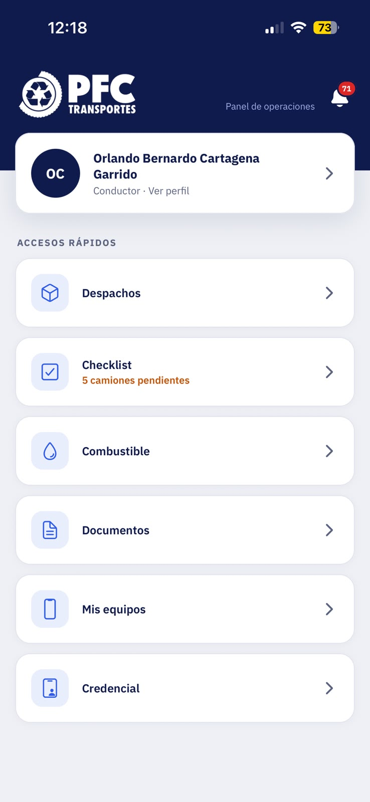

### Gestión de despachos
Visualización y administración de los despachos desde la aplicación móvil, vista de coordinadores.

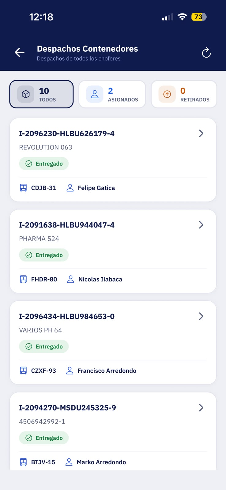

### Despacho asignado
Pantalla de consulta de los despachos asignados al conductor.

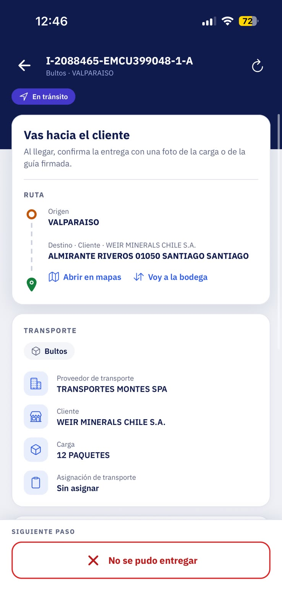

### Seguimiento de despachos
Consulta del estado y avance de los despachos desde la aplicación móvil.

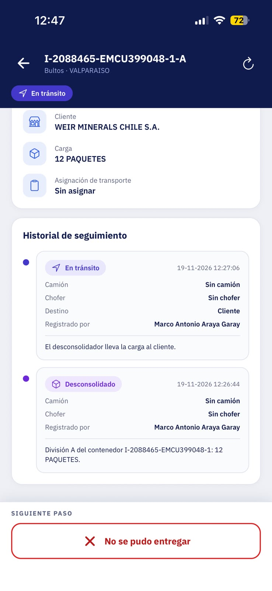

---

## 2. Portal de gestión y operaciones

### Gestión de despachos
Administración y seguimiento de las operaciones de transporte desde el portal interno.

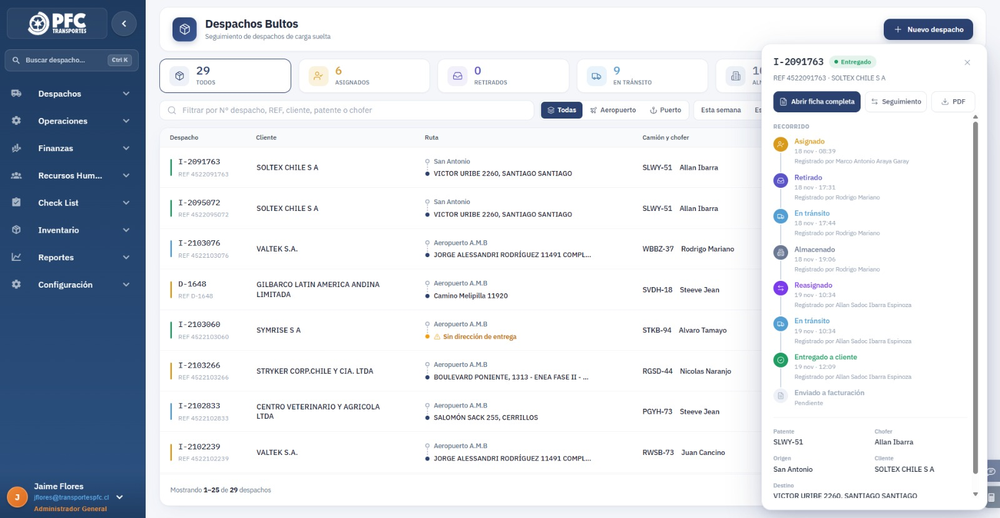

### Gestión de despachos del conductor
Funcionalidades orientadas al control y seguimiento de los despachos asociados a los conductores.

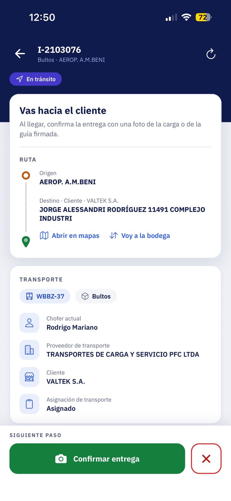

### Flujo de seguimiento
Visualización de las distintas etapas del proceso de despacho.

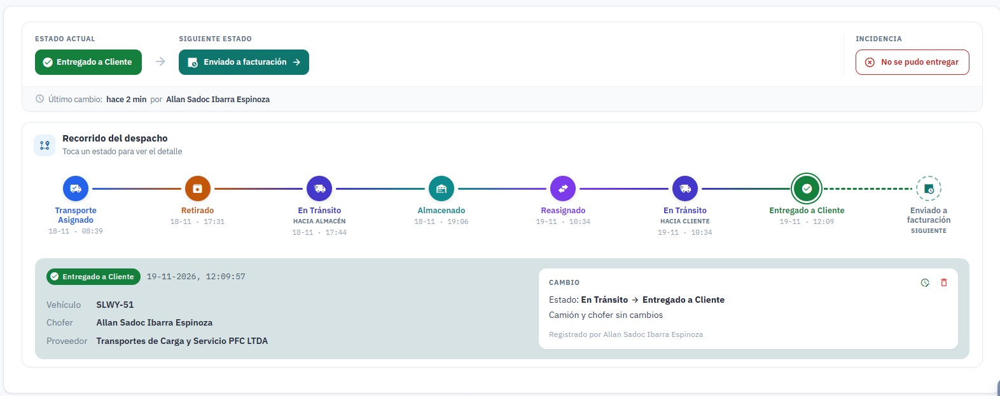

### Gestión de boletas
Interfaz correspondiente a la administración de boletas dentro del sistema.

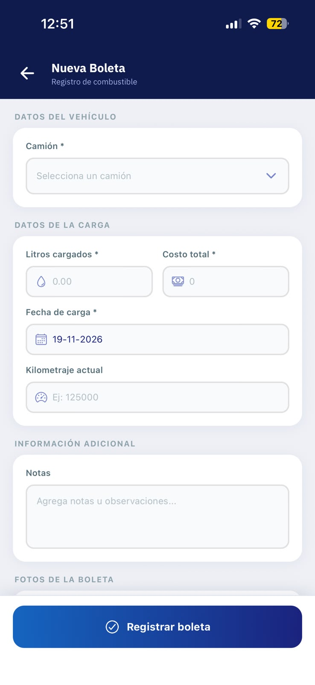

---

## 3. Gestión documental y firma electrónica

Módulo desarrollado para facilitar la administración de documentos de trabajadores y su firma electrónica simple desde la aplicación móvil.

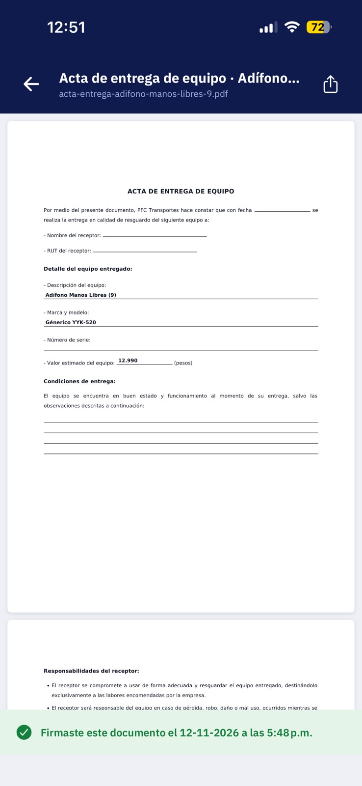

---

## 4. Inventario y gestión de dispositivos

### Control de inventario
Administración y seguimiento de los equipos y recursos tecnológicos de la empresa.

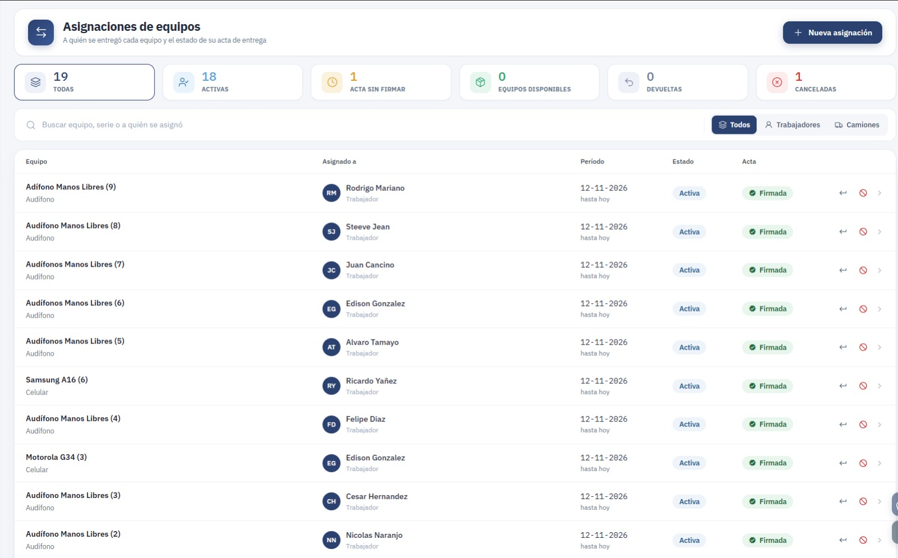

### Gestión de dispositivos
Consulta y administración de dispositivos asociados a la organización.

---

## 5. Indicadores financieros

### Indicadores financieros del portal
Visualización de indicadores que facilitan el seguimiento de información financiera y apoyan la toma de decisiones.

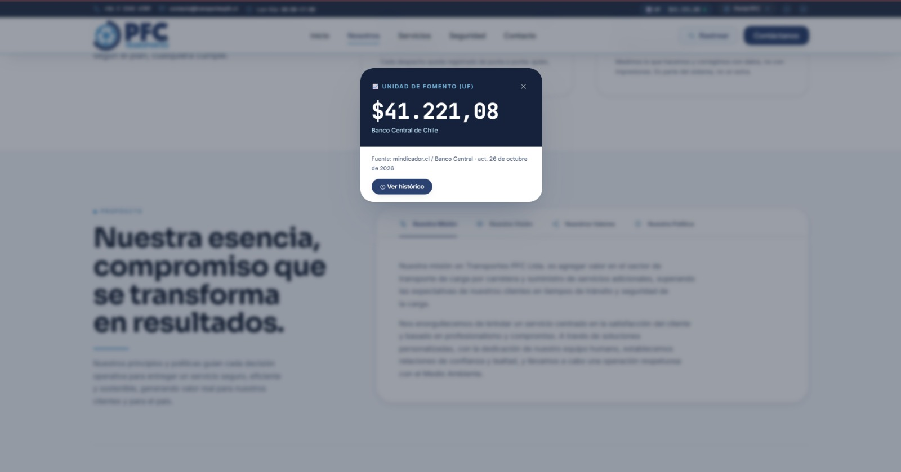

### Historial de indicadores
Consulta de información histórica para apoyar el seguimiento y análisis de indicadores financieros.

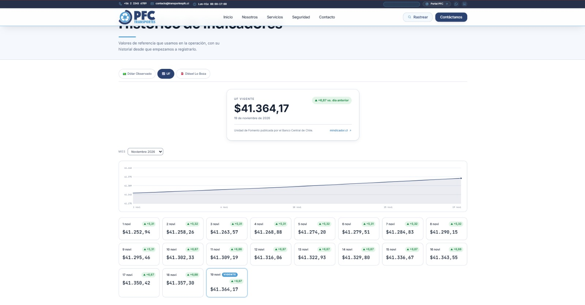

---

## 6. Seguimiento de despachos para clientes

Funcionalidad que permite consultar información relacionada con el estado y seguimiento de los despachos.

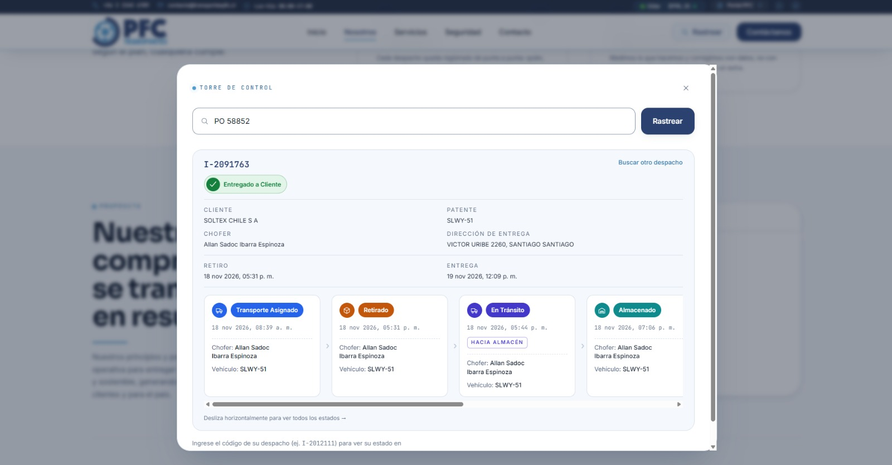

---

## Tecnologías utilizadas

- Laravel y PHP
- MySQL
- JavaScript
- React Native y Expo
- Git y GitHub
- Integraciones mediante API REST

---

**Transportes PFC Ltda. — Práctica Profesional de Ingeniería en Informática — 2026**
